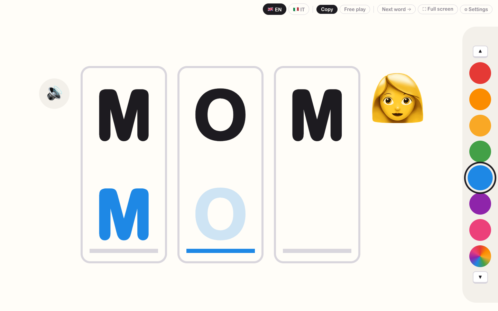

# TinyType

A simple typing game for toddlers. A word appears in big capital letters, and your child copies it underneath, one letter at a time, on a real keyboard. When the word is finished, TinyType says it out loud and celebrates.

**Try it: [tinytype.pages.dev](https://tinytype.pages.dev)**. Nothing to install; open it in a browser on a laptop or desktop.



- **Big, uppercase letters**, the same as the ones printed on the keyboard, whether Caps Lock is on or not
- **One slot per letter**, with the next letter gently blinking, very faint, in its slot
- **Colour picker**: each letter comes out in the colour chosen when it was typed
- **Gentle mistakes**: a wrong letter wobbles and plays a soft "bonk"
- **English and Italian**, with matching words and voice
- **No accounts, no tracking**: nothing leaves your computer. Settings are saved in your browser.

Made for a toddler who loves banging on the laptop keyboard. Works best on a laptop or desktop with a physical keyboard. A tablet version is planned.

## How to play

| Control | What it does |
|---|---|
| Letter keys | Type the next letter. Each correct letter is said out loud |
| Enter or 🔊 | Hear the whole word |
| ← → | Previous or next word (← retraces the words shown, in random order too) |
| Backspace | Delete the last letter |
| Coloured circles or ↑ ↓ | Choose the colour of the next letters (the ▲ ▼ keys on the picker show which keys to press). The last one is 🌈 rainbow: every letter gets all the colours |
| 🇬🇧 EN / 🇮🇹 IT | Switch language (words and voice) |
| **Copy** | A wrong letter wobbles and isn't kept, so the child tries again |
| **Free play** | Any letter is kept. Wrong ones show faded with a "bonk", and the child deletes them with Backspace |
| Next word → | Skip to the next word |
| ⛶ Full screen | Hides the browser bars so little hands can't click them |
| ⚙ Settings | Your own word list, in-order or random words, how many times each word repeats, hint letters, letter boxes, confetti |

**Tip:** use Full screen and stay nearby. A web page can't block shortcuts like Cmd+Q or Cmd+W.

## Install and run it on your computer

You need **Node.js**, the free program that runs TinyType's tools. You only install it once.

### 1. Install Node.js

- **Mac / Windows:** download the "LTS" installer from [nodejs.org](https://nodejs.org) and run it.
- **Mac with Homebrew:** `brew install node`

To check it worked, open a terminal (on Mac: the **Terminal** app; on Windows: **PowerShell**) and type:

```sh
node -v
```

You should see a version number, such as `v24.x.x`.

### 2. Download TinyType

Either:

- **No git:** on this page, click the green **Code** button → **Download ZIP**, then unzip it, or
- **With git:**
  ```sh
  git clone https://github.com/albey/tinytype.git
  ```

### 3. Start it

In the terminal, go into the TinyType folder and run two commands:

```sh
cd tinytype        # or wherever you unzipped it, e.g. cd ~/Downloads/tinytype-main
npm install        # first time only: downloads what TinyType needs
npm run dev        # starts TinyType
```

The terminal prints an address. Open **http://localhost:5173** in your browser and start typing.

To stop TinyType, click the terminal window and press **Ctrl+C**. Next time, you only need `npm run dev`.

## Choose the words

Open **⚙ Settings**:

- **Words:** type a word and press **Add**. The picture button next to it suggests a picture if TinyType knows the word (🍌 for BANANA). Click it to search for a picture by name in English or Italian (fish, pesce, dino…; Enter picks the first match), paste any emoji, or choose no picture. Tap **×** to remove a word, or tap it to practise it right away. Each language has its own list.
- **Order:** go through the words **in order**, or pick them **at random** (never the same word twice in a row).
- **Repeat each word:** from once to 5 times. Dots under the word show how many times it's been done.
- **Sounds:** switch each one on or off: **letter sounds** as he types, **say the word** when it's finished, and the **win sound**. The 🔊 button and Enter always work.
- **Help:** **pictures** next to the word (an emoji for about 130 common toddler words in English and Italian; other words simply have none), **hint letters** (the letters still to type in light grey), **letter boxes** (a box round each letter and its slot), and **confetti**.

Your words and settings are saved in this browser, so they're still there next time. Accented letters are fine: a plain **A** on the keyboard counts for **À**.

The starter words are in [`src/words.ts`](src/words.ts) if you want to change the defaults.

## Record the letter sounds

Computer voices can say letter names, but not letter sounds ("mmm", "b"), so TinyType plays recorded clips instead. To record your own:

1. Run TinyType with `npm run dev` (recording saves the clips into the app, so it needs the development server).
2. Open **⚙ Settings → 🎙 Record letter sounds**. It records for the language currently selected. The button only appears when TinyType runs locally, not on the website.
3. For each letter, **hold Space** while you say the sound shown (e.g. "mmm, as in mum"), then let go. It plays back straight away: hold Space again to redo it, or press **→** for the next letter. **P** plays it again.
4. Clips are trimmed, evened out in volume and saved as `public/sounds/<en|it>/<LETTER>.wav`. Green letters in the grid are done.

Letters without a recording use the computer voice. Tips: a quiet room, about a hand's width from the laptop, the same voice and volume for every letter; keep b, d, p, t short, and hold m, s, f, l for about a second.

## Roadmap

- [x] Copy a word letter by letter, colours, English and Italian, read-aloud
- [x] Your own word lists, random order, repeat each word, hear the word and each letter
- [ ] Tap a letter to hear it with an example ("A for Apple")
- [ ] Memory mode: hide the word, or show a picture to spell
- [ ] Online version, nothing to install
- [ ] iPad / tablet app with a big on-screen keyboard

## For developers

Built with [Vite](https://vite.dev), [React](https://react.dev) and TypeScript. No backend: settings are stored in `localStorage`, speech uses the browser's built-in Web Speech API, and sounds are generated with the Web Audio API.

```sh
npm run dev       # development server with live reload
npm run build     # type-check and build to dist/
npm run lint      # lint with oxlint
```

| File | What it does |
|---|---|
| `src/App.tsx` | Game state and keyboard handling |
| `src/components/WordRows.tsx` | The word and the typing slots |
| `src/components/ColourPicker.tsx` | Colour swatches |
| `src/components/Toolbar.tsx` | Language, mode, next word, full screen, settings |
| `src/components/SettingsPanel.tsx` | Word lists, order, repeats and help switches |
| `src/components/Confetti.tsx` | Full-screen confetti on a finished word |
| `src/words.ts` | Word lists and letter matching |
| `src/components/Recorder.tsx`, `src/recording.ts`, `src/letterClips.ts` | Recording, tidying and playing the letter-sound clips (saving is a dev-server plugin in `vite.config.ts`) |
| `src/speech.ts`, `src/sounds.ts` | Read-aloud, the "bonk" and the "ta-da" |
| `src/colours.ts` | The colours and the rainbow option |
| `src/pictures.ts` | The built-in emoji picture for each word, and the choices in the picture picker |
| `src/components/EmojiPicker.tsx` | The picture picker in Settings |

## Licence

[MIT](LICENSE): free to use, change and share.
